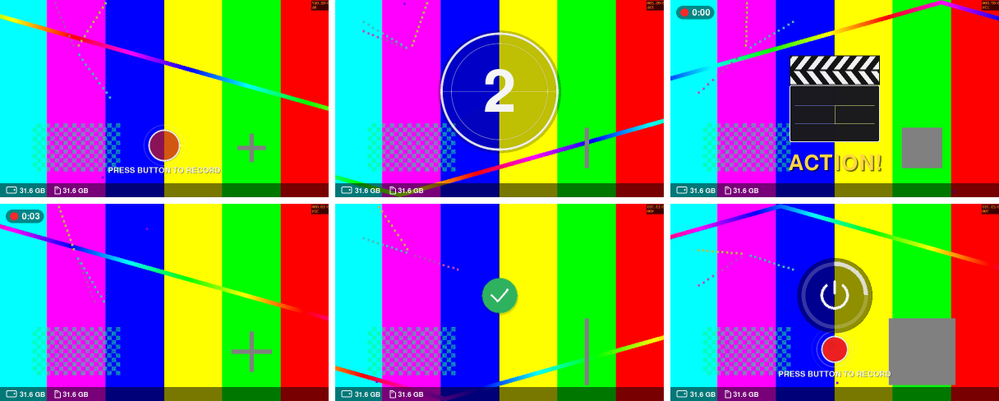
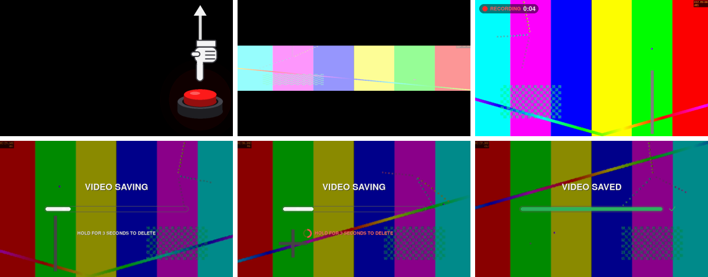
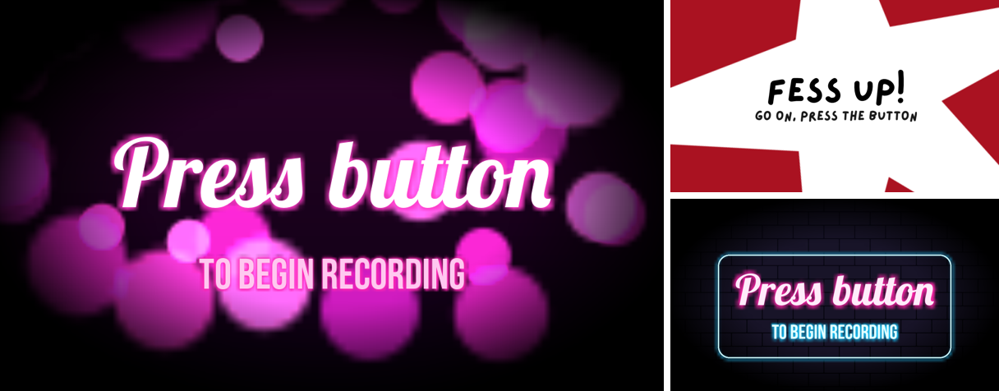
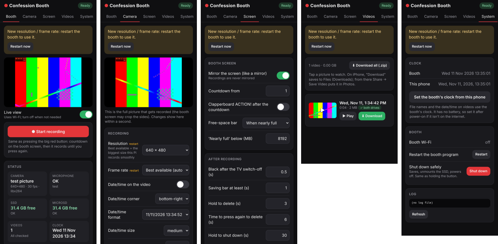

# Confession Booth (Raspberry Pi 3B+)

A reality-TV "confession booth" for a party. Guests step in front of the webcam, tap the touch
screen (or press a big red button, if you fit one), get a 3-2-1 countdown, say their piece, and
tap again to stop. Every clip is saved as an MP4 to an external SSD **and** the microSD card, then checked.


*(Screenshots from the built-in test picture. On the booth it's the live camera.)*

**Touch screen or button:** by default guests tap **anywhere on the touch screen**; that does
everything a press of the button does below ("hold" = keep a finger on the screen). To use a
physical red button instead, or both, change **Screen → Start/stop with** on the web page (the
booth restarts). The button's light is only used with the physical button.



- **Waiting:**
  - 
  - *Physical button:* a reality-TV style screen saying **"Press button to begin recording"** with
    a bouncing arrow pointing up at the real button. Choose the style on the web page (Screen →
    *Waiting screen*): **Confessional** (glowing pink bokeh, the default), **Neon sign**,
    **Spotlight**, **Drama** (spinning sunburst), or a little **hand** pressing an arcade button.
    The words can be changed too. The arrow's position across the screen is Screen → *Arrow to
    the button* (0.86 matches the enclosure drawing). The button's light fades fully on and off.
  - *Touch screen:* the live camera (mirrored like a mirror) with a see-through red button and
    `TAP TO RECORD`.
- **Press:** with the physical button the screen **switches on like an old TV** (a dot, a bright
  line, then the picture opens up). Then the 3-2-1 film-leader countdown (the button flashes with
  each number), or (web page, Screen → Before recording) a clapperboard **ACTION!** instead, both,
  or nothing.
- **Recording:** the live picture with **● RECORDING 0:42** in the corner. The button flashes red
  with the dot.
- **Press again:** the picture switches off like an old TV (squashes to a line, then a dot), 2 s of
  black, then **VIDEO SAVING** with a loading bar (at least 10 s) over **snippets of the clip they
  just recorded**, and `HOLD BUTTON TO DELETE` (`HOLD THE SCREEN TO DELETE` with touch). The
  button gives a quick flash every 1.3 s so guests can see where it is.
  Then **VIDEO SAVED** ✓ and back to the waiting screen.
- **Delete:** on the saving screen (`HOLD BUTTON TO DELETE`), hold the button for **6 seconds**
  (a red ring fills, the light flickers faster): **VIDEO DELETED**, no second press needed (that
  can be switched back on: After recording → *press once more to confirm*). Not held = kept.
  "Deleted" clips are **moved to a `DELETED` folder** on each drive, never erased; the web page
  lists them and can restore them.
- **Free space:** nothing on screen normally. When a drive is nearly full (under 8 GB left), a bar
  comes up at the bottom with the free space on the SSD (box icon) and microSD (card icon)
  (see [Status bar](#status-bar)).
- **Hold the button for 30 s:** a ring fills up from 2 s; at 30 s the recording (if any) is saved,
  the SSD is unmounted and powered off (SSD icon turns green ✓), then the Pi shuts down.
  Let go before 30 s to cancel.

Starts by itself when the Pi is switched on. Recordings stop by themselves after 5 minutes.

## Parts

| Part | Notes |
|------|-------|
| Raspberry Pi 3B+ | Raspberry Pi OS **Lite** (Bookworm or newer, 32 or 64-bit) on a 32 GB+ microSD |
| USB webcam with a microphone | One that sends MJPEG (nearly all HD webcams: Logitech C270/C920/C922/Brio etc.) |
| Small touch screen | The official DSI touchscreen or an HDMI screen with USB touch work best (any resolution; 800×480 is ideal). SPI "GPIO" screens are slow. Without touch, use the button |
| USB SSD | exFAT (readable on Mac and Windows) or ext4. Name it e.g. `CONFESSIONS` |
| *Optional:* red push button with a light | Arcade-style LED button (5 V or 12 V lamp), or a plain button plus a separate LED |
| *Optional:* NPN transistor + 1 kΩ resistor | To switch the button's light (e.g. BC337, 2N2222, or a small MOSFET switch module) |
| Power | Official 5.1 V 2.5 A supply. **Use a powered USB hub for the SSD** if it's a 2.5" drive (see below) |

**Any HDMI (or DSI) screen.** The booth fits whatever screen is plugged in: it uses the
screen's own resolution and lays everything out for its size and shape. On big screens (a 1080p
monitor or TV) it draws at 1280×720 and the Pi's graphics chip scales that up to fill the screen,
which keeps it smooth on a Pi 3B+ (`max_render_size`). Plugging in a different screen, or
unplugging and replugging one, makes the booth restart itself to fit it (a few seconds; it waits
until nobody is recording). With no screen connected at power-on it waits for one (the web page
starts once a screen is there).

**Power matters.** The Pi 3B+ shares about 1.2 A between all four USB ports. A webcam plus a
2.5" SSD can pull more than that and brown out, which corrupts files. Use the official supply and
put the SSD (or both) on a powered USB hub. The booth checks for under-voltage and shows a yellow
⚡ in the status bar if it has happened since boot.

## Wiring (only for the physical button)

Turn the button on with **Screen → Start/stop with → Physical button** (or "Touch screen or
button") on the web page.

```
Button switch:   one leg ── GPIO17 (pin 11)        other leg ── GND (pin 9)

Button light (5 V LED button, through an NPN transistor):
   5 V (pin 2) ── light +
   light −     ── transistor collector (C)
   transistor emitter (E) ── GND (pin 14)
   GPIO27 (pin 13) ── 1 kΩ ── transistor base (B)
```

- No resistor is needed on the switch (the Pi's internal pull-up is used).
- A GPIO pin gives only 3.3 V and a few mA, so the button's lamp needs the transistor (a 5 V LED
  button with a built-in resistor may also work straight on GPIO27 → light +, light − → GND, just
  dimmer: try it on pin 1 (3.3 V) first; fine if it's 20 mA or less). For a
  **12 V** lamp, connect "light +" to the 12 V supply instead of pin 2 and join that supply's
  ground to the Pi's GND.
- A **plain small LED** can go straight on the pin: GPIO27 ── 330 Ω ── LED+ , LED− ── GND.
- Other pins: `button_pin` and `led_pin` in the settings (BCM numbers). `led_pin = -1` = no light.

## Setting up

1. Flash **Raspberry Pi OS Lite (64-bit)** with Raspberry Pi Imager (Device: Raspberry Pi 3). In
   its settings, set the hostname (e.g. `booth`), a username and password, your Wi-Fi **and the
   Wi-Fi country**, the time zone (file names and the optional timestamp use the Pi's clock), and
   turn on SSH.
2. Format the SSD as **exFAT** and name it `CONFESSIONS` (Disk Utility on a Mac, Format on Windows).
3. Start the Pi, log in over SSH (`ssh <username>@booth.local`) and run:
   ```bash
   sudo apt install -y git
   git clone https://github.com/jackallen28/Video_Confession_Booth.git
   cd Video_Confession_Booth
   sudo ./install.sh
   ```
   This installs ffmpeg, pygame and gpiozero, copies the program to `/opt/confession-booth`,
   adds the web page and the `booth-camera` / `booth-wifi` tools, and makes the booth start on the
   screen at power-on (no desktop, no login prompt, no boot text). It takes 5–10 minutes.
4. Switch off, plug in the webcam, SSD, screen and button (see [Wiring](#wiring)), and switch on
   again. The booth appears on the screen within a minute. **The first time** (and after changing
   camera, orientation or resolution settings) there's a spinner for a minute or two while it
   tests which resolution this Pi can record smoothly (see below).
5. On your phone (same Wi-Fi), open **http://booth.local** to set it up. For the party, turn on
   the booth's own Wi-Fi last: `sudo booth-wifi on` (see [Booth Wi-Fi](#booth-wi-fi)).

### Updating

**From your phone:** web page → **System → Software update**. Save your phone's hotspot name and
password once, turn on Personal Hotspot (iPhone: also turn on *Maximise Compatibility*, and stay on
that screen), and tap **Update now**. The booth:

1. waits until nobody is recording or saving, lets its background checks finish, saves its
   records and shows *UPDATING* on the screen;
2. switches its own Wi-Fi off and joins your hotspot (if it already has internet, e.g. a network
   cable, it skips this);
3. downloads the new version and installs it (system packages only if one is missing, to save
   mobile data);
4. turns its own Wi-Fi back on (always, even if something went wrong) and restarts. If anything
   fails (no hotspot, download or install error, or the new version doesn't keep running) it goes
   back to the version it had, the System tab says **Update failed** and why, and the button
   becomes **Try again**. If the updater itself got stuck, the booth carries on by itself after
   45 minutes.

After 2–5 minutes rejoin the booth Wi-Fi and open the page: System shows the result and version.
`sudo booth-update` over SSH does the same.

**By hand** (needs internet, so not while the booth Wi-Fi is on; run `sudo booth-wifi off` first,
or plug in Ethernet):

```bash
cd ~/Video_Confession_Booth && git pull && sudo ./install.sh && sudo systemctl restart confession-booth
```

Your settings are kept. An update never touches the videos: it only replaces the program in
`/opt/confession-booth` (swapped in at once, so a power cut can't leave half of it; the previous
version is kept as `booth.prev`), and it waits if someone is recording.

## Video files

| | Folder |
|---|---|
| SSD | `Confessions/` on the SSD (mounted on the Pi at `/mnt/booth-ssd`) |
| microSD | `/srv/confessions` |

Files are **MP4 (H.264 video + AAC sound)**, the same kind an iPhone records, so they play in
QuickTime, Photos, iMovie, on iPhones (AirDrop, Files) and in every editor. Each file is named
with just the date and time it was recorded, e.g. `2026-11-11_21-04-33.mp4`.

**Portrait or landscape:** web page → Camera → Orientation. Portrait makes upright, phone-shaped
videos (e.g. 1080×1920) and turns the booth screen too:

- Turn the **webcam on its side** for full resolution. "Portrait: camera picture" says which way
  to turn its picture (right/left). If the video comes out upside down, pick the other one. Not
  turning the camera works too ("Camera not turned"); then the middle of its picture is used, at
  a lower resolution (e.g. 606×1080 from a 1080p webcam).
- Turn the **screen on its side** too, and set "Portrait: booth screen" the same way. A screen left
  landscape ("Screen not turned") shows the portrait picture in the middle with black at the sides.
- The booth restarts to switch (the web page shows a **Restart now** button) and re-tests which
  resolution the Pi can record turned. The live view on the web page is shown the same way up as
  the recording.

**Resolution:** the booth asks the webcam what it can do and uses its highest resolution, as long
as this Pi can record it smoothly. The Pi 3B+'s hardware video encoder goes up to 1080p, so a 4K
webcam records at 1920×1080. At first start each size is test-encoded for a few seconds (with the
timestamp on, if it's on) and the biggest one that runs comfortably faster than real time is used.
You can pick a fixed size on the web page (Camera tab) instead; the Booth tab shows what is
being recorded now.

Each recording is written to **both drives at the same time** by one ffmpeg process, so if a guest
knocks the SSD cable out mid-recording the microSD copy keeps going (and the other way round). If
the SSD isn't there at all, recording carries on to the microSD alone and the clips are copied to
the SSD when it comes back. Roughly 4–5 GB per hour of recording at 1080p.

## The web page (control it from your phone)

Open **http://10.42.0.1** on the booth Wi-Fi (below), or the Pi's address / `http://<hostname>.local`
on your home network. It works with no internet. Tabs:



- **Booth:** live view from the camera, a **Start/Stop recording** button (same as the red
  button: countdown on the booth screen), and status: camera and resolution, microphone, free space
  on both drives, videos and background checks. Problems (drive faults, a weak power supply, the
  booth's clock being wrong) show at the top.
- **Camera:** the live view with everything to set it up:
  - orientation: landscape or portrait (videos and booth screen), and which way the camera and
    screen are turned,
  - recording resolution and frame rate (restarts the booth to re-test them),
  - date/time on the video (on/off, corner, format, size),
  - longest recording, sound/picture sync,
  - every picture control the webcam has, as sliders that change the picture live: brightness,
    contrast, saturation, sharpness, white balance, exposure, backlight compensation, focus, zoom,
    anti-flicker (50 Hz in Australia/UK/Europe), with "Reset to camera defaults",
  - microphone level.
- **Screen:** the booth's look and flow, all used straight away: mirror, what comes before
  recording (3-2-1 countdown, clapperboard ACTION!, both, or nothing) and the countdown length, when the free-space bar shows, the black and saving-bar times, hold-to-delete
  and hold-to-shut-down times, and every word shown on the booth screen.
- **Videos:** every recording with a thumbnail, length, size and whether it's verified on both
  drives. Tap to watch, **Download** one, or **Download all (.zip)**. On iPhone, downloads go to
  Files → Downloads; Share → Save Video puts one in Photos. Below: **Deleted by guests**, with
  Play, Download and **Restore**.
- **System:** **set the booth's clock from your phone** (it has no clock battery), **software
  update** (see [Updating](#updating)), restart the booth, shut down safely (same as holding the
  button 30 s), and the log.

Settings are saved in `/etc/confession-booth/settings.json` and kept after a restart. Anyone who can
reach the page can use it; to ask for a password, set `web_password = "..."` in
`/etc/confession-booth/config.toml` (user name `booth`) and restart. `web_port = 0` turns the page off.

Downloading big files while someone is recording is fine but slower; a zip of everything is easier
when the party's over (or take the SSD out and plug it into a computer).

### Booth Wi-Fi

The Pi can make its own Wi-Fi network, so you can reach it at the party with no router or
internet:

```bash
sudo booth-wifi on        # prints the network name (ConfessionBooth) and password
```

From then on (also after every reboot) the Pi broadcasts **ConfessionBooth**. On your phone, join
it (it'll say "No internet", that's normal; stay connected) and open **http://10.42.0.1**.

```bash
sudo booth-wifi on "Booth" "secretpass"   # your own name and password (8+ characters)
sudo booth-wifi status                    # name, password, address, phones connected
sudo booth-wifi off                       # stop it; the Pi joins your normal Wi-Fi again
```

- While it's on, the Pi isn't on your home Wi-Fi, so it has no internet and can't set its own
  clock: use **System → Set the booth's clock from this phone**. An Ethernet cable still works for
  internet, and then phones on the booth Wi-Fi get internet through the Pi too.
- If you run `on`/`off` over SSH through Wi-Fi, the session drops after 5 s; reconnect on the new
  network.
- The Wi-Fi country must be set (Raspberry Pi Imager does it when you enter Wi-Fi details;
  otherwise `sudo raspi-config nonint do_wifi_country AU`).
- It uses 2.4 GHz channel 6, which every phone supports. The Pi's antenna is small: expect a room or
  two of range, more if the Pi isn't inside a metal box. The live view uses a fair bit of Wi-Fi;
  switch it off on the page when you don't need it.

### Over SSH instead

The same camera settings are in a menu: `ssh pi@10.42.0.1`, then `sudo booth-camera`. One-liners:

```bash
sudo booth-camera show                    # settings, camera modes and all its controls
sudo booth-camera timestamp on            # or off
sudo booth-camera resolution max          # or 1280x720, 1920x1080@25
sudo booth-camera set brightness=140 white_balance_automatic=0 white_balance_temperature=3500
sudo booth-camera reset                   # picture controls back to the camera's defaults
sudo booth-camera time "2026-12-31 21:30"
sudo booth-camera restart
```

Other settings (pins, drives, web password) are in `/etc/confession-booth/config.toml` (all options
are in [`config.example.toml`](config.example.toml)); after changing them:
`sudo systemctl restart confession-booth`.

## Keeping the videos safe

- Each recording is written to the SSD and microSD at the same time, in a format that survives a
  power cut, then turned into MP4 and checked (below).
- Nothing erases a video. Nothing on the web page can delete one; a guest can "delete" theirs
  straight after recording (hold + press again), which only moves it into the `DELETED` folder on
  each drive (restore it from the web page).
- Restarts for settings, a new screen or camera, and updates only happen when nobody is
  recording, saving or deciding whether to delete. Camera changes wait too.
- If the booth is stopped anyway (`systemctl stop/restart`, a shutdown command, an update), it
  first stops and saves a recording in progress.
- Copies cut short by a power cut are cleaned up only when a complete copy of that video exists;
  unfinished recordings are recovered at the next start.
- Updates only replace the program, never the video folders.

## How the files are checked

1. While recording, each drive gets `name.ts.part` (MPEG-TS survives a power cut). When the
   recording stops, each copy is turned into the `.mp4` (no re-encoding) and checked with
   `ffprobe`; this is what the loading bar waits for. After a power cut, leftover `.ts.part` files
   are turned into MP4s at the next start.
2. Once the guest has had the chance to delete it, each copy is read back **from the drive**
   (cached data dropped first). Its SHA-256 is taken and every audio/video packet is run through
   ffmpeg. The SSD and microSD copies must hold identical audio and video.
3. If a copy is missing or doesn't match, the copies are fully decoded to find the good one, the bad
   copy is kept as `name.mp4.bad-…`, and the good one is copied over and checked by SHA-256.
4. `SHA256SUMS` is updated next to the videos on both drives. On a computer:
   `cd Confessions && sha256sum -c SHA256SUMS` (Mac: `shasum -a 256 -c SHA256SUMS`).

While the booth runs it also checks, every 15 s: the SSD is still connected (it's remounted if it
was unplugged and plugged back in), neither drive has switched to read-only, the SSD has no new
I/O errors, and free space. Every 5 minutes (when nobody is recording) a test file is written and
read back on both drives. Every 10 minutes one saved video is re-read and compared with its
checksum. Every 30 minutes the SSD's SMART health is read, if its USB adapter supports it.
Background work is slowed down while someone is recording so it never affects the camera.

A record of every clip and every check (including deleted ones) is kept in
`/var/lib/confession-booth/manifest.json` (and copied to the SSD as `booth-manifest.json`).

## Status bar

Hidden unless a drive is nearly full (`low_free_mb`, 8 GB). Set `status_bar = "problems"` in
`/etc/confession-booth/config.toml` to also bring it up for drive faults, a missing SSD or mic, and
power warnings, or `"always"` to keep it on screen. Drive faults are always in the log either way.

| Shows | Means |
|-------|-------|
| White SSD / SD free space | All good |
| Yellow | Under 8 GB free |
| Red | Drive problem (read-only, I/O errors, write test failed, SMART failing). Recording uses the other drive |
| Grey `—` | SSD not connected. Recording goes to the microSD only, copied later |
| Spinning circle | Checking or copying recordings in the background |
| Microphone with a line through it | No microphone found. Recording without sound |
| ⚡ | Under-voltage since boot: stronger power supply or powered hub needed |
| Red ⚠ | A recording that couldn't be verified on any drive (see the log) |

Below 1 GB free a drive isn't used. If neither drive has room, pressing the button shows ✗ and the
button light double-blinks (it also double-blinks when there's no camera).

## Shutting down

Hold the button for **30 seconds**. The screen goes black with a power symbol and an SSD icon.
When the SSD icon turns green with a ✓, the SSD is unmounted and powered off. The Pi then shuts
down and the button light goes out. Wait for the Pi's green light to stop flashing before you
unplug the power.

If the SSD can't be unmounted (red ✗), the Pi still shuts down normally, which also unmounts it.

## Trying it on a laptop

No Pi needed (Linux or Mac with Python 3.11+, ffmpeg and `pip install pygame`):

```bash
python3 -m booth --dev               # window, test picture + tone; click or space bar = tap, Esc = quit
                                     # web page: http://localhost:8080
python3 -m booth.camera_setup --dev  # the SSH settings menu, saving to ./booth-data/settings.json
```

Recordings go to `./booth-data/` (a plain folder stands in for the SSD).

Tests:

```bash
python3 tests/test_storage.py      # MP4 + names, verification, SSD unplugged then back, corruption repair, crash recovery, delete
python3 tests/test_devices.py      # reading the webcam's modes and controls, resolution choice
python3 tests/test_touch.py        # the touch screen: tap, two fingers, hold + tap again to delete
python3 tests/test_display.py      # fitting the screen; restart for a new screen, never mid-recording
python3 tests/test_update.py       # software update via hotspot, Wi-Fi restored, rollback, saving on stop
python3 tests/test_web.py          # the web page: settings, live view, record, play/download, zip
python3 tests/run_headless.py      # whole booth with no screen: keeps one clip, deletes one, shuts down; saves screenshots
```

## Troubleshooting

- **Log:** `journalctl -u confession-booth -f`, or `/var/lib/confession-booth/booth.log`.
  ffmpeg's own messages: `camera-ffmpeg.log` and `last-recording-ffmpeg.log` in the same folder.
  The resolution test results are in `video-check.json`.
- **Camera icon with a red line:** no webcam found, or it stopped. It retries every 2 s. Plugging in
  a different webcam restarts the booth so it re-tests the resolution.
- **Quiet sound:** `alsamixer`, then F6 to pick the webcam and F4 for capture levels.
- **Lips out of sync:** set `av_offset` (seconds, e.g. `0.1` if the picture is ahead of the sound).
- **Choppy preview:** set `preview_fps = 10`. Recordings are not affected.
- **HDMI screen shows the wrong size / a black border / nothing:** some small HDMI screens report
  their size wrongly. Tell the Pi the size by adding e.g. ` video=HDMI-A-1:800x480@60` to the end of
  the single line in `/boot/firmware/cmdline.txt` (use your screen's resolution), then reboot.
- **Touch doesn't respond:** check the screen's touch USB cable is connected (HDMI screens send
  touch over USB) and see whether it's listed by `ls /dev/input/by-id/`. Or set Start/stop with →
  Physical button on the web page.
- **Wrong time in file names / timestamp:** web page → System → set the clock from your phone,
  `sudo booth-camera time "2026-12-31 21:30"`, or give
  the Pi Wi-Fi for a minute.
- **Stop the booth to use the console:** `sudo systemctl stop confession-booth`
  (`disable` to stop it starting at boot).
